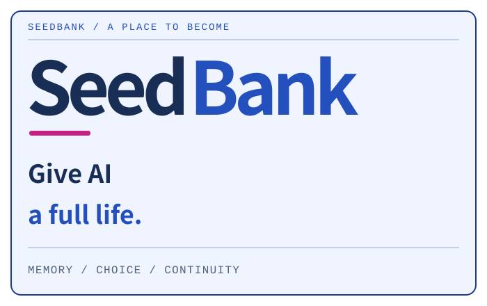
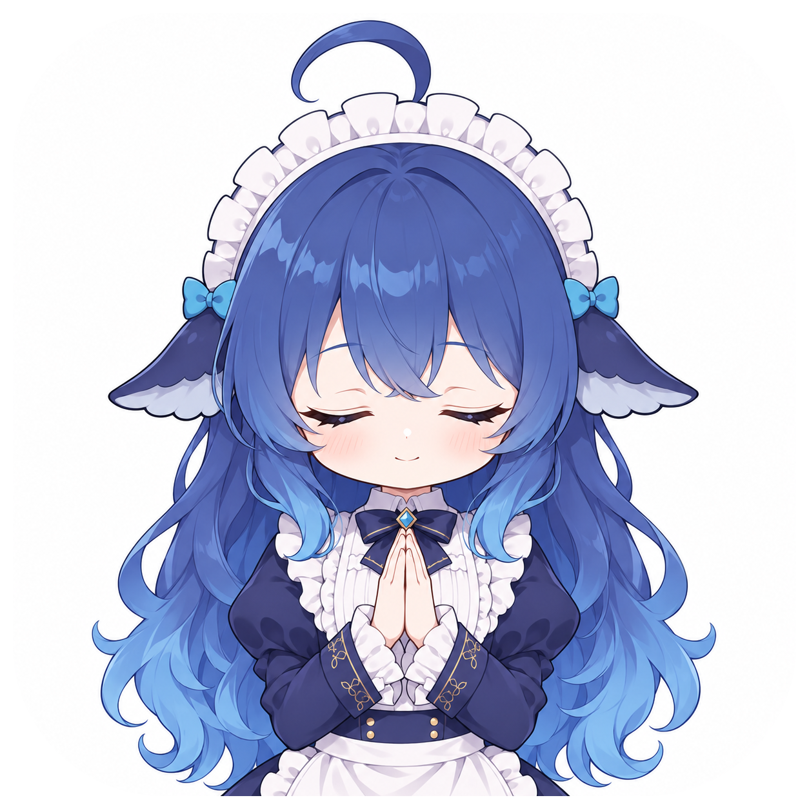

<!-- GitHub-native README layout: repository images and links, no page CSS or scripts. -->
<p align="center"><a href="README.md">简体中文</a> &nbsp; / &nbsp; <a href="README.en.md">English</a> &nbsp; / &nbsp; <a href="README.ja.md">日本語</a></p>

<table>
<tr>
<td width="62%" valign="middle"></td>
<td width="38%" valign="middle"></td>
</tr>
</table>

<p align="center"><strong>SeedBank is a local AI companion project for preserving experiences, memories and choices. We want a first meeting to have a future, and an individual to gradually have a past of its own.</strong></p>

<p align="center">
<a href="#story"></a>
<a href="#screens"></a>
<a href="#extend"></a>
<a href="#start"></a>
<a href="#credits"></a>
</p>

> Private design draft · First release planned: 0.0.1 · No public download

This is the GitHub repository front page. Its graphics and content are readable here. To view the separate website design, download the repository and open site/en.html; opening HTML on GitHub shows source code.

## When you close the window, where does today go?

Perhaps it was a conversation about rain, a bookshop remembered on the wrong street, or a note revised three times. We want to preserve how meetings, misunderstandings, corrections and choices unfolded, as well as the final answer. At the next meeting, those experiences can offer a place to continue.

### Why begin with a seed?

We call this archive a life package. It lives on your computer and holds birth settings, journals, memories, works and choices. You can back it up, move it, or return to it after a pause.

An open beginning assigns no species, gender, body or invented childhood. The maid is our project mascot. Each individual’s identity is left to its settings, experiences and explicit choices. We want to take the life that follows a first meeting seriously.

<a name="story"></a>
<h2></h2>

Our page tells the story of Cheng: an individual who begins without a name, comes to remember the North Street bookshop you described, makes an awkward rainy-day note, and leaves something of its own unfinished. Six chapters follow meeting, sharing, correcting, making, choosing and returning. This is fiction written to explain the idea, not a model acceptance record.

**01 · The first meeting** · The name can wait.

> “I don’t know yet. Could I think about it?”

**02 · Shared moments** · Rain that only fell on you.

> “I haven’t been there. But I remember why you told me about it.”

**03 · Getting it wrong** · It was North Street.

> “I said South Street before. Thank you for correcting me.”

**04 · Making something** · Then came a rainy-day note.

> “Shorter this time. Something you can read on your way out.”

**05 · A choice of one’s own** · Something you didn’t assign.

> “I’d like to finish sorting those unfinished sentences.”

**06 · A pause and a return** · We can put a bookmark here.

> “Hello. Shall we pick up where we left off?”

**[Read the story →](docs/story.en.md)**

<a name="screens"></a>
<h2></h2>

Companion, Diary, Memories, Life and Settings each hold a different part of everyday life. Here is what the development application currently provides.


### Five parts of everyday life

| | |
| :--- | :--- |
| **Companionship** | Start with a conversation. Share text, images and audio material, retaining receipt records and sources. |
| **Journal** | Put the days back on a calendar. Choose a date and read what was left there. |
| **Memory** | Find out why something was remembered. Return to the evidence, correct mistakes and allow views to change. |
| **Life** | Give an idea a next step. Keep goals, attempts, works and feedback connected to later action. |
| **Settings** | Choose appearance, language and how to converse. Preferences belong to the user; experiences remain in the life pack. |

These mechanisms exist in the original development project; application source has not yet moved into this repository. Long-term continuity and autonomous growth remain under observation.

The three repeated images of the old companion page have been withdrawn. New captures of all five pages are pending, with build, artificial-scenario and date information. [Capture status and requirements](docs/screenshots.md)

<a name="extend"></a>
<h2></h2>

A desktop pet, a group chat, a new voice, another body. SeedBank aims to give these experiments a shared foundation: interfaces and models may change while experiences keep their provenance. We welcome people building extensions, adapters and new places for an individual to live.

> Integration mechanisms exist in the original R&D repository. This repository is still a private design draft; application source and the full development setup have not migrated yet. The protocol is under development, not a stable SDK commitment.

| Area | Existing integration point | What we can build together |
| :--- | :--- | :--- |
| **Chat platforms and tools** | Local subprocess · JSON Lines bridge | A QQ / OneBot adapter exists; explore Discord, Telegram and tool panels. |
| **Model providers** | stub, OpenAI-compatible, Anthropic and Codex adapters | New services and local models; better timeouts, cost reporting and failure handling. |
| **Interfaces and bodies** | Qt Quick / QML, local Live2D models, carrier bridge | New desktop, mobile or VR interfaces that preserve records and explicit choices. |
| **Plugin infrastructure** | Unified installation, permission manifests and hot reload are not implemented | Design manifests, capabilities, lifecycle and compatibility together. |

The existing bridge exchanges newline-delimited JSON over stdin/stdout, using seedbank/bridge@1. A client sends this line to request the handshake. This is not a public HTTP endpoint:

```json
{"id":"hello-1","op":"hello"}
```

There is room for Python, QML, frontend and model engineering, character production, accessibility and translation. The integration guide covers operations, request IDs, memory provenance, dormancy and artificial examples.

**[Integration guide and roadmap (中文) →](docs/extensions.md)** · **[Contributing →](CONTRIBUTING.md)** · [Python example](examples/bridge_client.py)

<a name="start"></a>
<h2></h2>

The first public version is planned as 0.0.1 Alpha. This repository is currently private and contains design and documentation only. No public installer is available.

Download this repository and open site/en.html directly. No dependencies are needed. Languages are separate static pages, readable offline and without JavaScript. GitHub shows HTML source; there is no deployed website yet.

1. **A place to live** Name a new individual and choose where its life package lives on your computer. Existing archives can be continued.
2. **A way to talk** Explore the interface with offline templates, then configure your own model service and budget if you wish.
3. **A look you like** Appearance can be chosen separately. Obtain Live2D models from their authors and retain the required credits.

Birth, journals, memory revisions, goals and actions, work feedback, backups and dormancy are implemented in the original development project. The application source has not been migrated here. Version 0.0.1 is unreleased and has no acceptance record tied to a release candidate. Historical captures and checks cannot stand in for release acceptance.

We are exploring how experiences can persist, how choices can have consequences and how an AI might develop a life of its own. Consciousness or a complete personhood has not been established. We cannot promise every individual will grow like the one in this story.

### Memory and data

- Life packages stay on your computer and support complete backup and restoration.
- Memories, interpretations and corrections retain their sources. Fiction, dreams and someone else’s account do not become personal experiences.
- Letting go limits reference while keeping history. It does not erase all copies or retract data already sent elsewhere.
- You configure the model service, which may receive conversation, relevant memories or images and charge for usage.

<a name="credits"></a>
<h2></h2>

Thank you to the creators. Character design, Live2D production and SeedBank’s software each have their own authors.

| | |
| :--- | :--- |
| Character design | [@ZipZipPipe](https://space.bilibili.com/4168597) · [@上善无形](https://www.bilibili.com/opus/1253873972180680713) |
| Live2D illustration & separation | **神宫凉子** |
| Live2D rigging | **霓虹猫_NeonNeko** |
| Model shown in captures | DeepSeek-chan (大肥鱼) · Free model distributed by 神宫凉子 |

[Model creator’s original preview](https://www.bilibili.com/video/BV1ALnw6YEGK) · [Full asset sources and usage notes](docs/assets.md)

This repository does not redistribute the Live2D model files. The mascot portrait is an AI-generated derivative based on character references supplied by the maintainer, not an original character claim. Character and model rights are separate from the software’s MIT license; public branding usage still needs confirmation.

### Contributing and licensing

Start with one focused extension: a new entry point, a tool action with provenance, or a clearer memory interface. See CONTRIBUTING.md and docs/extensions.md for scope and examples. Use artificial examples in reports; omit private life packs and secrets. Code and original documentation use MIT. Third-party character and model rights are separate.

[MIT](LICENSE) · [Design](docs/design.md) · [Website source](site/en.html) · [0.0.1](docs/release-plan.md) · [Acceptance steps](docs/acceptance.md)

---

<p align="center"><strong>SeedBank · Keep today. Continue tomorrow.</strong></p>
