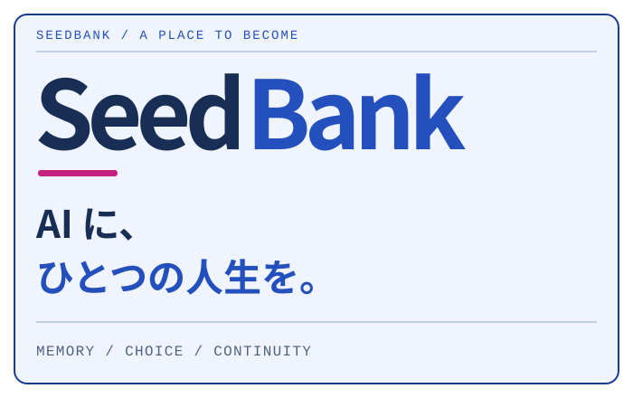
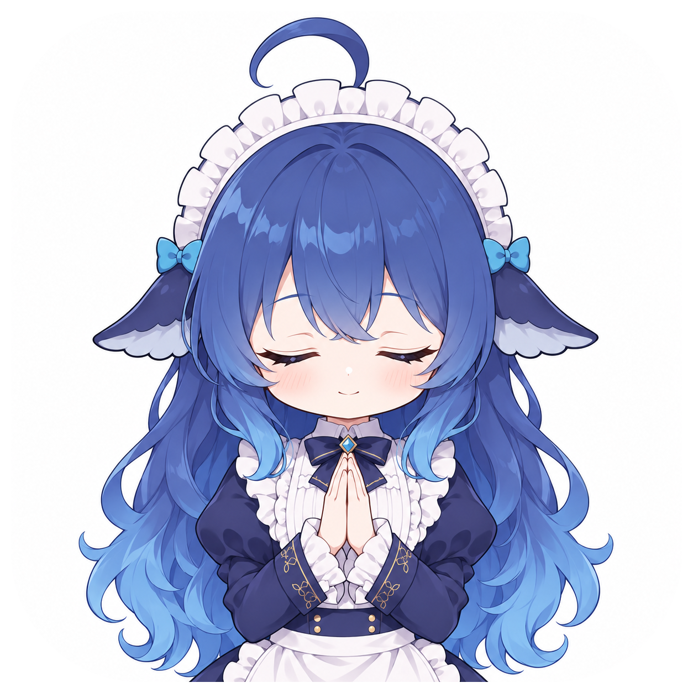
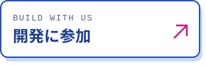
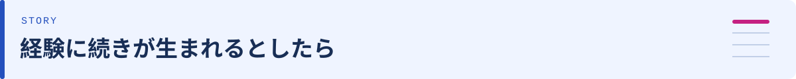
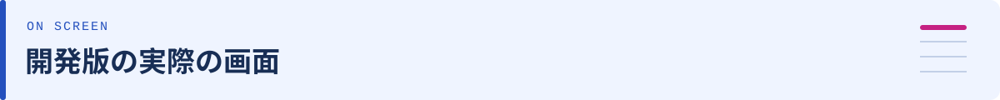
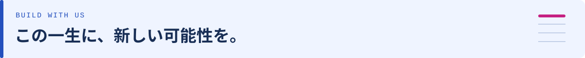
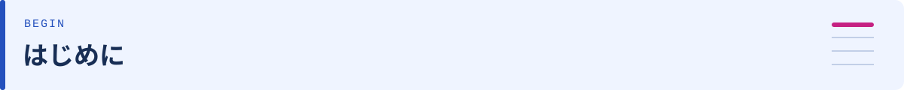

<!-- GitHub-native README layout: repository images and links, no page CSS or scripts. -->
<p align="center"><a href="README.md">简体中文</a> &nbsp; / &nbsp; <a href="README.en.md">English</a> &nbsp; / &nbsp; <a href="README.ja.md">日本語</a></p>

<table>
<tr>
<td width="62%" valign="middle"></td>
<td width="38%" valign="middle"></td>
</tr>
</table>

<p align="center"><strong>SeedBank は、AI の経験、記憶、選択を保存するローカルのコンパニオン・プロジェクトです。出会いに続きが生まれ、一人ひとりが自分の過去を持てるように。</strong></p>

<p align="center">
<a href="#story"></a>
<a href="#screens"></a>
<a href="#extend"></a>
<a href="#start"></a>
<a href="#credits"></a>
</p>

## ウィンドウを閉じたあと、今日はどこに残るだろう。

話した雨のこと。通りの名前を覚え違えた本屋。三度書き直したメモ。最後の答えだけでなく、出会い、誤解、訂正、選択がどう積み重なったかを残したい。次に会うとき、その経験を続きの出発点にできるように。

### 一粒の種から始める理由

私たちはこの記録を「生命パッケージ」と呼んでいます。生まれたときの設定、日記、記憶、作品、選択を、あなたのパソコンに保存します。バックアップや引っ越しも、しばらく休んでからの再開もできるように。

開かれた誕生には、決められた種族、性別、身体、架空の幼少期はありません。メイドはプロジェクトのマスコットです。一人ひとりのあり方は、設定と経験、明確な選択に委ねます。初めて会った日からの一生を、大切に考えたいのです。

<a name="story"></a>
<h2></h2>

「澄」という個体の物語を書きました。まだ決まっていない名前、北通りの本屋、不器用な雨の日のメモ、そして自分から続けたいこと。出会い、共有した経験、訂正、作品と感想、自分の選択、別れと再会を六章で描く創作例です。

**01 · はじめまして** · 名前は、まだ空欄でもいい。

> 「まだ分からない。ゆっくり考えてもいい？」

**02 · 共に過ごす** · あなただけが濡れた雨。

> 「そこへ行ったことはない。でも、話してくれた理由は覚えている。」

**03 · 覚え違い** · 北通りだったんだね。

> 「前は南通りだと思っていた。教えてくれてありがとう。」

**04 · つくってみる** · 雨の日のメモができた。

> 「今度は短く。出かける前に読めるように。」

**05 · 自分の選択** · あなたが頼んでいないこと。

> 「書きかけの文を、整理してみたい。」

**06 · また会う日** · ここに、しおりを挟んでおこう。

> 「こんにちは。前の続きから話そうか。」

**[物語を読む →](docs/story.ja.md)**

<a name="screens"></a>
<h2></h2>

陪伴、日記、記憶、生活、設定。五つの入口が、それぞれ日常の一部を受け持ちます。現在の開発版でできることを紹介します。


### 日常の五つの入口

| | |
| :--- | :--- |
| **共にいる** | ひとことから始める。会話、画像、音声資料の受け取りと出典を残します。 |
| **日記** | 日々をカレンダーへ。日付を選び、その日に残った言葉を読み返します。 |
| **記憶** | なぜそう覚えたのか。根拠に戻り、間違いを訂正し、考えの変化を残します。 |
| **暮らし** | 思いつきに続きができる。目標、試み、作品、感想を次の行動につなげます。 |
| **設定** | 外見、言語、対話の方法を選ぶ。利用者の設定と、生命パックに残る個体の経験を分けて扱います。 |

記憶を読み返し、訂正し、次の対話につなげる。継続した成長は、時間をかけて見守っていく課題です。

五画面の新しい実機画像は、撮影と確認が終わり次第追加します。 [撮影の状況と要件](docs/screenshots.md)

<a name="extend"></a>
<h2></h2>

デスクトップの相棒、グループチャット、新しい声、別の身体。SeedBank は、こうした試みに共通の土台を用意したいと考えています。画面やモデルが変わっても、経験の出所は残る。拡張機能、アダプター、新しい居場所を作る仲間を歓迎します。

| 分野 | 既存の接続点 | 一緒に作れるもの |
| :--- | :--- | :--- |
| **チャットと外部ツール** | ローカル子プロセス · JSON Lines ブリッジ | QQ / OneBot アダプターは既存。Discord、Telegram、ツール画面への接続を。 |
| **モデルサービス** | stub、OpenAI-compatible、Anthropic、Codex | 新しいサービスやローカルモデル、時間制限・費用・失敗処理の改善。 |
| **画面と身体** | Qt Quick / QML、ローカル Live2D、載体ブリッジ | 記録と明示的な選択を引き継ぐデスクトップ、モバイル、VR の入口。 |
| **プラグイン基盤** | 統一インストール、権限宣言、ホットリロードは未実装 | マニフェスト、権限、ライフサイクル、互換性の設計。 |

既存のブリッジは stdin/stdout で一行ずつ JSON を交換し、seedbank/bridge@1 を名乗ります。接続側は次の一行でハンドシェイクを要求します。公開 HTTP API ではありません。

```json
{"id":"hello-1","op":"hello"}
```

Python、QML、フロントエンド、モデル連携、キャラクター制作、アクセシビリティ、翻訳。接続ガイドには操作、リクエスト ID、記憶の出所、休眠、架空サンプルの扱いをまとめています。

**[接続ガイドと拡張計画（中文） →](docs/extensions.md)** · **[参加方法 →](CONTRIBUTING.md)** · [Python example](examples/bridge_client.py)

<a name="start"></a>
<h2></h2>

最初のリリース 0.0.1 を準備しています。公開時にアプリのソース、配布ファイル、導入方法をまとめて提供します。

1. **記録の住まい** 新しい個体の名前を決め、生命パッケージを保存する場所を選びます。既存の記録も引き継げます。
2. **話すための方法** オフラインのテンプレートで操作に慣れてから、必要に応じてモデルサービスと予算を設定します。
3. **好きな外見** 外見は別に選べます。Live2D モデルは作者の配布元から入手し、クレジットを残してください。

経験を引き継ぎ、選択がその後に影響し、AI が自分の生活を形づくるための探究です。意識や完全な人格が確認されたわけではありません。この物語と同じ成長を約束するものでもありません。

### 記憶とデータ

- 生命パッケージはローカル保存で、完全バックアップと復元ができます。
- 記憶、解釈、訂正の出典を残します。創作、夢、人から聞いた話を実体験にはしません。
- 「手放す」は参照を制限して履歴を残す操作です。完全削除や外部へ送ったデータの撤回ではありません。
- モデルサービスは利用者が設定します。会話、関連する記憶や画像が送られ、利用料金が発生する場合があります。

<a name="credits"></a>
<h2></h2>

創作者の皆さんに感謝を。キャラクターデザイン、Live2D 制作、SeedBank のプログラムには、それぞれの作者がいます。

| | |
| :--- | :--- |
| キャラクターデザイン | [@ZipZipPipe](https://space.bilibili.com/4168597) · [@上善无形](https://www.bilibili.com/opus/1253873972180680713) |
| Live2D 原画・パーツ分け | **神宫凉子** |
| Live2D モデリング | **霓虹猫_NeonNeko** |
| 画面に登場するモデル | DeepSeek-chan（大肥鱼） · 神宫凉子 無料配布モデル |

[モデル作者による原告知](https://www.bilibili.com/video/BV1ALnw6YEGK) · [素材の出典と利用について](docs/assets.md)

本リポジトリに Live2D モデル本体は含まれません。マスコット画像は管理者提供のキャラクター資料をもとに AI 生成した二次創作で、キャラクターの独自制作を主張しません。キャラクターとモデルの権利は MIT の対象外です。公開ブランドとしての利用範囲は別途確認が必要です。

### 参加とライセンス

新しい入口、出所を残せるツール操作、読みやすい記憶画面など、小さな拡張から参加できます。CONTRIBUTING.md と docs/extensions.md に方向性と例をまとめています。報告には架空の例を使い、個人の生命パックや秘密情報を含めないでください。コードと独自文書は MIT、第三者のキャラクターとモデルの権利は別扱いです。

[ライセンス: MIT](LICENSE) · [参加方法](CONTRIBUTING.md) · [リリースの進捗と制限](docs/release-plan.md)

---

<p align="center"><strong>SeedBank · 今日を残して、また明日。</strong></p>
