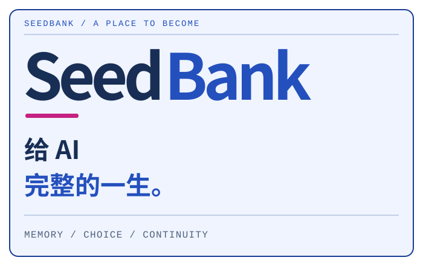

<!-- GitHub-native README layout: repository images and links, no page CSS or scripts. -->

<a href="README.md">简体中文</a> &nbsp; / &nbsp; <a href="README.en.md">English</a> &nbsp; / &nbsp; <a href="README.ja.md">日本語</a>

<table>
<tr>
<td width="62%" valign="middle"></td>
<td width="38%" valign="middle"></td>
</tr>
</table>

<strong>SeedBank 是一个为 AI 保存经历、记忆与选择的本地陪伴项目。我们想让一次相遇有后续，让一个个体慢慢拥有自己的过去。</strong>

> 私有设计稿 · 首发计划 0.0.1 · 暂无公开下载

当前这里是 GitHub 仓库首页。下方图形与内容可直接阅读；独立网页设计需要下载仓库后打开 site/index.html，点击 HTML 文件在 GitHub 上只会显示源码。

## 你关掉窗口以后，今天会留在哪里？

也许是一场聊过的雨，一家记错街名的书店，一张改了三次的便签。我们想保存的不只是最终答案，还有相遇、误解、修正与选择怎样一步步发生。下次见面时，这些经历可以成为继续的起点。

### 为什么从一颗种子开始

我们把这份档案叫作生命包。它住在你的电脑里，承载出生、日记、记忆、作品和选择。你可以带着它搬家、备份，也可以在一段暂停之后继续。

开放出生不预设物种、性别、身体或虚构童年。眼前的女仆是品牌形象；每个个体的身份，留给设定、经历和明确选择。我们想认真对待的，是从初次见面开始的那一生。

<h2></h2>

在页面里，我们写了一个名叫「澄」的个体：起初连名字都没想好，后来记住你说过的北街书店，写过一张笨拙的雨天便签，也留下过自己想继续的事。六章讲述初次见面、共同经历、记错以后的修正、作品与反馈、自己的选择，以及暂别与重逢。它是创作示例，不是模型验收记录。

**01 · 初次见面** · 名字先空着，也没关系。

> 「我还不知道。可以慢慢想吗？」

**02 · 共同经历** · 一场只淋湿了你的雨。

> 「我没去过那里，但我记得你为什么提起它。」

**03 · 记错以后** · 原来，是北街。

> 「上次记成南街了。谢谢你告诉我。」

**04 · 做一点事** · 后来，多了一张雨天便签。

> 「这次写短一点，留给出门前的你。」

**05 · 自己的选择** · 还有一件，你没有布置的事。

> 「我想把那些没写完的句子整理好。」

**06 · 暂别与重逢** · 这一页，可以先夹起来。

> 「你好，我们接着上次的地方。」

**[读这段故事 →](docs/story.md)**

<h2></h2>

下面是已有研发版本的真实程序画面，来自独立人工场景。截图摄于 2026-11-03，使用当天 01:50 研发版；早于当前品牌调整，不代表 0.0.1 已完成验收。

<table>
<tr>
<td width="50%"></td>
<td width="50%"></td>
</tr>
<tr><td><strong>一次招呼</strong> · 1280 × 840</td><td><strong>小窗口里的陪伴</strong> · 860 × 640</td></tr>
</table>

[截图的版本与来源](docs/screenshots.md) · DeepSeek-chan（大肥鱼） / 神宫凉子 / 霓虹猫_NeonNeko

### 日常的五个入口

| | |
| :--- | :--- |
| **陪伴** | 从一句话开始。分享对话、图片与声音材料，留下接收记录与来源。 |
| **日记** | 把日子放回日历。选中一天，重新读一读那时留下的文字。 |
| **记忆** | 看看为什么这样记。回到依据，留下更正，也允许看法发生改变。 |
| **生活** | 让想法有下文。保存目标、尝试、作品与反馈，接上下一次行动。 |
| **延续** | 把档案带在身边。本机生命包、完整备份、明确休眠与恢复。 |

以上为原研发版本已有机制；应用源码尚待迁入本库。长期连续性与自主成长仍需观察。

<h2></h2>

首个公开版本计划为 0.0.1 Alpha。目前仓库保持私有，仅包含设计与文档，没有公开安装包。

下载本库后，双击 site/index.html 查看介绍页，无需安装依赖。语言切换为独立静态页面，离线及关闭 JavaScript 时仍可阅读。GitHub 展示 HTML 源码，当前没有在线站点。

1. **一处住处** 为新的个体取名，选择本机生命包的保存位置。已有档案可以继续使用。
2. **一种对话方式** 先用离线模板熟悉操作，再按需要配置自己的模型服务与预算。
3. **一个喜欢的外观** 外观可以另行选择。Live2D 模型请从作者渠道取得，并保留素材署名。

出生、日记、记忆修订、目标与行动、作品反馈、备份与休眠恢复等实现仍在原研发库。本库尚未迁入应用源码，0.0.1 未发布，也没有绑定该候选的通过记录。历史截图和检查不能替代首发验收。

我们在探索怎样让经历延续、让选择有后果、让 AI 逐渐形成自己的生活。当前没有证据证明意识或完整人格，也不承诺每个个体都会像这段故事一样成长。

### 记忆与数据

- 生命包保存在本机，可完整备份与恢复。
- 记忆、理解与修订分别保留来源。创作、梦和转述不变成亲身经历。
- 「放下」限制引用而保留历史，不等于彻底删除或撤回已外发的数据。
- 模型服务由使用者配置，可能接收对话、相关记忆或图片，并按服务计费。

<h2></h2>

谢谢创作者们。角色设计、Live2D 制作与 SeedBank 的程序开发各有来处。

| | |
| :--- | :--- |
| 人设 | [@ZipZipPipe](https://space.bilibili.com/4168597) · [@上善无形](https://www.bilibili.com/opus/1253873972180680713) |
| Live2D 原画及拆分 | **神宫凉子** |
| Live2D 建模 | **霓虹猫_NeonNeko** |
| 截图中使用的模型 | DeepSeek-chan（大肥鱼） · 神宫凉子免费配布模型 |

[模型作者原始预告](https://www.bilibili.com/video/BV1ALnw6YEGK) · [完整素材来源与使用说明](docs/assets.md)

本库不分发 Live2D 模型本体。品牌头像是依据维护者提供的角色参考生成的衍生图，不能因此声称角色原创。角色与模型素材不随程序适用 MIT 许可，公开品牌使用范围还需确认。

### 参与与许可

公开后欢迎可复现的问题、文档改进和记忆与生命周期设计讨论。反馈请使用人工示例，不附私人生命包或密钥。代码与自撰文档使用 MIT；第三方角色和模型的权利不包含在其中。

[MIT](LICENSE) · [Design](docs/design.md) · [网页源文件](site/index.html) · [0.0.1](docs/release-plan.md) · [Acceptance steps](docs/acceptance.md)

---

<strong>SeedBank · 把今天留下来，明天再继续。</strong>

